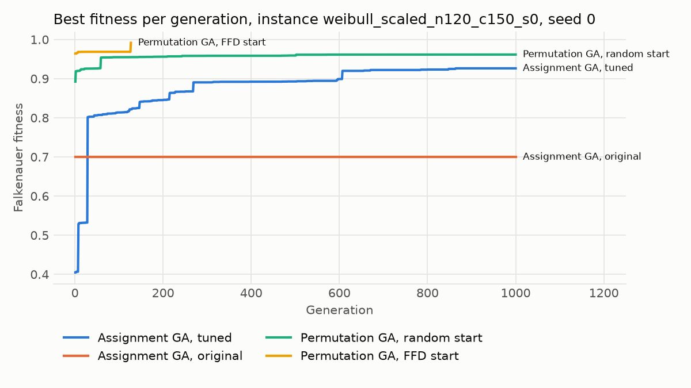

# Bin Packing Problem: A Comparison of Solvers

The bin packing problem is a classic combinatorial optimization problem. Given items of different sizes and an unlimited supply of identical bins, the goal is to pack every item into as few bins as possible without exceeding the bin capacity.

This project began as an undergraduate computer science assignment. Originally, the task was to implement a genetic algorithm to solve the bin packing problem. It worked for that assignment with simple cases, but it often produced invalid packings for more complex instances.

I wanted to see how well other solvers would do, so I implemented a few more and compared them on generated instances. The results are below.

## Solvers

| Solver | Idea |
|---|---|
| **FFD, BFD, WFD, RFD** | Heuristics. Sort items from largest to smallest; put each in the first (FFD), fullest (BFD), emptiest (WFD) or a random (RFD) bin where it fits. |
| **Assignment GA** | The undergraduate algorithm. Each gene says which bin an item goes to. Bins may overflow; overflow is penalized. |
| **Permutation GA** | Each chromosome is an order of the items; First Fit packs them in that order, so every candidate is valid. |
| **Simulated annealing (SA)** | Starts from one packing and keeps moving or swapping items between bins, sometimes accepting worse packings early on. |

Each search method appears in two versions:

- **Assignment GA, original**: the simplistic and original undergraduate parameters. Each gene mutates with probability 0.2, the overflow penalty is mild, and each generation has 25 children.
- **Assignment GA, tuned**: one gene mutated per child on average, a stronger overflow penalty, and 50 children per generation.
- **Permutation GA, random start**: the first population is random orders of the items.
- **Permutation GA, FFD start**: the first population includes the FFD order of the items, which is a strong baseline.
- **SA, cooling**: classic annealing, cooling from T = 10⁻⁵ to 10⁻⁸.
- **SA, greedy**: same annealing, but near zero temperature, so it never accepts a worse packing. It still accepts moves that leave the packing equally good, which is how it keeps searching.

## Results

**Setup:** 20 generated instances (10 with 120 items, 10 with 500; bin capacity 150; item sizes drawn from a Weibull distribution, about 40% of the capacity on average), each solved 3 times with different random seeds. The genetic algorithms ran up to 1,000 generations; the simulated annealing tried up to about 1 million moves.

The optimum of an instance is not known in advance, so results are compared with a **lower bound**: no packing can use fewer bins than the total item size divided by the bin capacity, rounded up. (The stronger L2 bound of Martello & Toth gives the same number on all 20 instances.)

**How to read the tables:**

- **Gap**: how many bins a run used above the lower bound, as a percentage of the bound, averaged over valid runs. Lower is better.
- **Optimal**: valid runs that used exactly the lower bound. Nothing can use fewer bins, so these are proven optimal.
- **Invalid**: runs that ended with no valid packing at all (only the Assignment GA can produce these). They are left out of the gap, so its gap averages only 2 runs at 120 items (original) and 6 at 500 items (tuned).
- **Time**: seconds per run; each run uses one core.

### 120 items

| Solver | Gap | Optimal | Invalid | Time |
|---|---:|---:|---:|---:|
| FFD | 1.42% | 9/30 | 0 | < 0.01 s |
| BFD | 1.42% | 9/30 | 0 | < 0.01 s |
| WFD | 2.03% | 0/30 | 0 | < 0.01 s |
| RFD | 1.89% | 2/30 | 0 | < 0.01 s |
| Assignment GA, original | 12.00% | 0/30 | 28 | 2.3 s |
| Assignment GA, tuned | 4.20% | 0/30 | 0 | 3.9 s |
| Permutation GA, random start | 1.35% | 10/30 | 0 | 21 s |
| Permutation GA, FFD start | 0.87% | 17/30 | 0 | 13 s |
| SA, cooling | 0.60% | 21/30 | 0 | 0.5 s |
| **SA, greedy** | **0.33%** | **25/30** | 0 | 0.3 s |

### 500 items

| Solver | Gap | Optimal | Invalid | Time |
|---|---:|---:|---:|---:|
| FFD | 0.54% | 0/30 | 0 | < 0.01 s |
| BFD | 0.54% | 0/30 | 0 | < 0.01 s |
| WFD | 0.59% | 0/30 | 0 | < 0.01 s |
| RFD | 0.58% | 0/30 | 0 | < 0.01 s |
| Assignment GA, original | — | 0/30 | 30 | 6.7 s |
| Assignment GA, tuned | 8.58% | 0/30 | 24 | 9.8 s |
| Permutation GA, random start | 1.58% | 0/30 | 0 | 234 s |
| Permutation GA, FFD start | 0.28% | 13/30 | 0 | 176 s |
| SA, cooling | 0.13% | 22/30 | 0 | 1.2 s |
| **SA, greedy** | **0.05%** | **27/30** | 0 | 0.8 s |

### Findings

1. **Simulated annealing is the clear winner.** It has the lowest gap at both sizes, in about a second.
2. **The encoding makes or breaks a genetic algorithm.** In the Assignment GA, bin numbers mean nothing across parents, so crossing two good packings can produce an overflowing one, and the penalty can let an overflowing packing outscore a valid one. The original version ends invalid in 58 of 60 runs; even tuned, it never beats FFD. The Permutation GA is always valid, but it only clearly beats FFD when its first population includes the FFD item ordering, and it is by far the slowest.
3. **Cooling did not help.** With these settings, the greedy SA beat the cooled one at both sizes.
4. **FFD is a strong baseline.** On average it is within 1.5% of the lower bound, in milliseconds.

When a run stays above the lower bound, the true optimum is unknown: it may itself be above the bound, so part of the gap may not be the solver's fault.



The chart above follows the genetic algorithms on one 120-item instance. Fitness is higher for fuller bins (1.0 means every bin is full). The Assignment GA, original stays flat because its whole population overflows bins.

## Running it

Requires [uv](https://docs.astral.sh/uv/).

```bash
git clone https://github.com/NicolasFloresF/bin_packing.git
cd bin_packing
uv sync
```

Reproduce the results above (about 30 minutes on 8 cores):

```bash
uv run python -m bin_packing generate --num-items 120 --capacity 150 --count 10 --out data/raw/readme
uv run python -m bin_packing generate --num-items 500 --capacity 150 --count 10 --out data/raw/readme
uv run python -m bin_packing run --config experiments/readme.toml
uv run python -m bin_packing summarize results/readme
uv run python -m bin_packing plot results/readme
```

Solvers and their parameters are listed in [experiments/readme.toml](experiments/readme.toml). Copy it to set up your own comparison.
